# Bursztyn OS

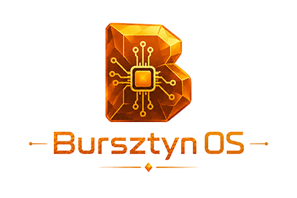

## Czym jest Bursztyn OS?

**Bursztyn OS** to niezależny, polski system operacyjny dla architektury **x86-64**, rozwijany od podstaw bez wykorzystania Linuksa, Windowsa ani innego gotowego jądra jako bazy.

Projekt obejmuje własne:

- jądro systemu,
- zarządzanie pamięcią fizyczną i wirtualną,
- procesy Ring 3 i planistę,
- Bursztynowe Wywołania Systemowe (BWS),
- model bezpieczeństwa PZB 0–5,
- system plików BSP2/PSF,
- sterowniki sprzętowe,
- natywny stos sieciowy,
- środowisko graficzne i kompozytor,
- framework **BursztynUI**,
- format wykonywalny `.bur`,
- paczki aplikacji `.cebula`,
- instalator,
- system aktualizacji A/B z automatycznym rollbackiem,
- aplikacje systemowe.

W wybranych obszarach wykorzystywane są jawnie wskazane biblioteki zewnętrzne dostosowane do środowiska bare-metal, m.in. **mbedTLS** do kryptografii i połączeń TLS.

Projekt rozpocząłem **13 czerwca 2026 r.** i rozwijam go samodzielnie.

> **Status projektu:** aktywny rozwój / eksperymentalny system operacyjny.  
> Bursztyn OS posiada już kompletne środowisko testowe z aplikacjami Ring 3, GUI, siecią, instalatorem i aktualizacjami, ale nadal jest rozwijany i stabilizowany. Nie jest jeszcze systemem produkcyjnym.

### Kod źródłowy i licencja

Niniejsze repozytorium zawiera dokumentację techniczną i specyfikację interfejsów Bursztyn OS.

Kod źródłowy systemu, pliki binarne oraz wewnętrzne repozytorium implementacyjne nie są publikowane w tym repozytorium. Bursztyn OS jest oprogramowaniem własnościowym (**proprietary / closed-source**) i podlega odrębnej licencji.

---

## Środowisko graficzne i aplikacje Ring 3

Bursztyn OS posiada własne środowisko okienkowe działające od framebufferu aż po aplikacje użytkownika Ring 3.

Warstwa graficzna obsługuje obecnie trzy backendy:

- **UEFI GOP**,
- **VESA VBE**,
- **Bochs VBE** dla środowisk wirtualnych.

Menedżer Okien działa jako proces Ring 3. System posiada m.in.:

- pulpit,
- pasek zadań,
- Menu Start,
- ikony pulpitu,
- Z-Order,
- focus i capture wejścia,
- minimalizację, maksymalizację i zamykanie okien,
- przeciąganie okien,
- popupy i menu,
- powiadomienia typu toast,
- skalowanie interfejsu.


### BursztynUI

**BursztynUI** to natywny framework GUI z polskojęzycznym API, rozwijany specjalnie dla Bursztyn OS.

Aktualny inwentarz frameworka obejmuje około **62 publiczne kontrolki, dialogi i elementy infrastruktury**.

Wśród nich znajdują się m.in.:

- `Okno`, `Panel`, `Kolumna`, `Wiersz`,
- `Etykieta`, `Przycisk`, `PoleTekstowe`, `PoleWielowierszowe`,
- `PoleWyboru`, `PrzyciskOpcji`, `Przelacznik`,
- `Suwak`, `PasekPrzewijania`, `PasekPostepu`,
- `ListaWyboru`, `ListaRozwijana`, `Drzewo`,
- `Tabela`, `TabelaWirtualna`, `ListaWirtualna`,
- `WidokIkon`, `WidokMiniatur`, `WidokDrzewiastoKolumnowy`,
- `Karty`, `Rozdzielacz`, `Siatka`, `PanelDokowany`, `Przeplyw`,
- `MenuGlowne`, `MenuKontekstowe`, `ElementMenu`,
- `PasekNarzedzi`, `PasekStanu`, `PasekInformacyjny`,
- `PasekSciezki`,
- `Kalendarz`, `PoleDaty`, `PoleCzasu`,
- `EdytorFormatowany`,
- `PoleWyszukiwania`, `PoleSugestii`,
- `SelektorKoloru`,
- `PowierzchniaRysunkowa`, `Wykres`,
- `WskaznikZajetosci`,
- `Powiadomienie`,
- `OknoDialogowe`,
- `DialogPliku`,
- `DialogKoloru`,
- `DialogKomunikatu`,
- `PolecenieUI`, `ListaPolecen`,
- `PowierzchniaPopup`, `ZarzadcaPopupow`.

Framework posiada również wspólny system poleceń, menu kontekstowe, obsługę klawiatury, runtime theme integration oraz skalowanie interfejsu.

### Skalowanie i tryby obrazu

BursztynUI obsługuje obecnie skale:

- 100%,
- 125%,
- 150%,
- 175%,
- 200%.

Dla backendu Bochs VBE lista trybów jest pobierana dynamicznie ze sterownika. W testowym środowisku QEMU przy odpowiedniej ilości VRAM dostępne są m.in.:

- 800×600,
- 1024×768,
- 1280×720,
- 1280×800,
- 1360×768,
- 1600×900,
- 1920×1080,
- 2560×1440,
- 3840×2160.

Zmiana rozdzielczości posiada mechanizm potwierdzenia i automatycznego rollbacku, jeśli użytkownik nie zaakceptuje nowego trybu.

---

## Formaty aplikacji

Bursztyn OS używa własnego ekosystemu aplikacji.

### `.bur`

Natywny plik wykonywalny aplikacji Ring 3.

Program `.bur` jest ładowany do osobnej przestrzeni adresowej i komunikuje się z jądrem przez BWS.

### `.cebula`

Paczka aplikacji zawierająca program, manifest i zasoby.

Przykładowa struktura:

```text
notatnik.cebula/
├── opis.aplikacji
├── notatnik.bur
├── ikona.bmp
└── zasoby/
```

### `opis.aplikacji`

Manifest zawiera metadane i deklarowane prawa aplikacji. Jądro wykorzystuje go razem z modelem PZB i maskami `PRAWO_*`.

Przykład uruchomienia:

```text
uruchom /programy/notatnik.cebula/notatnik.bur
```

Docelowo formaty `.bur` i `.cebula` mają być zintegrowane z językiem **Avocado**.

---

## Co już działa?

Bursztyn OS posiada obecnie między innymi:

- własne 64-bitowe jądro x86-64,
- sprzętową separację Ring 0 / Ring 3,
- własny PMM i VMM,
- wielozadaniowość i obsługę wielu procesów,
- scheduler Round-Robin,
- APIC i HPET,
- aplikacje działające w osobnych przestrzeniach adresowych,
- model bezpieczeństwa **PZB 0–5**,
- maski uprawnień `PRAWO_*`,
- własne BWS wykonywane przez `SYSCALL`,
- współdzieloną pamięć SHM,
- IPC między procesami,
- obserwowanie zmian plików,
- clipboard obsługujący formaty MIME,
- kursory systemowe i kursory własne aplikacji,
- osobne kolejki zdarzeń GUI,
- pulpit i Menedżer Okien Ring 3,
- framework BursztynUI,
- popupy, dialogi i powiadomienia,
- dynamiczną zmianę rozdzielczości,
- skalowanie UI 100–200%,
- UEFI GOP, VESA VBE i Bochs VBE,
- system plików **BSP2/PSF**,
- trwały zapis na dyskach SATA przez AHCI,
- GPT i ESP FAT32 w instalatorze,
- natywny stos USB xHCI,
- klawiaturę i mysz USB HID,
- obsługę wejścia PS/2 jako starszą ścieżkę,
- sterownik Intel E1000,
- ARP,
- IPv4,
- ICMP,
- UDP,
- DHCP,
- DNS,
- TCP,
- HTTP,
- HTTPS/TLS,
- BWS socket facade dla TCP/IPv4,
- dźwięk Intel HDA,
- własny format tapet `.btp`,
- automatyczne ładowanie i zmianę tapet,
- konwerter JPG/PNG → BTP,
- graficzny instalator Bursztyn OS,
- aktualizacje systemu A/B,
- automatyczny rollback po nieudanym rozruchu,
- weryfikację pakietów aktualizacji przez SHA-256 i RSA-2048,
- aplikację **Aktualizacje Systemu**.

---

## Aktualne ograniczenia

Bursztyn OS jest nadal rozwijany. Obecnie istotne ograniczenia obejmują:

- brak SMP — system używa obecnie jednego logicznego CPU,
- brak sprzętowej akceleracji GPU,
- brak NVMe jako działającego backendu blokowego w aktualnym instalatorze,
- brak USB Mass Storage jako docelowego dysku instalacji,
- brak obsługi dysków 4Kn w instalatorze,
- Secure Boot musi być obecnie wyłączony,
- brak swapu i kompresji pamięci,
- brak pełnego IPv6,
- obecny stos TCP pozwala na jedną systemową sesję TCP jednocześnie,
- brak pełnego publicznego API strumieni audio i miksowania,
- część zaawansowanych scenariuszy GUI nadal jest aktywnie stabilizowana.

Aktualny instalator dyskowy jest przeznaczony dla **UEFI x86-64 + SATA AHCI + sektor logiczny 512 B/512e**.

---

## Bursztynowe Wywołania Systemowe — BWS

BWS to własny interfejs komunikacyjny pomiędzy Ring 3 i jądrem.

Program użytkownika przekazuje numer operacji i argumenty, a następnie wykonuje instrukcję:

```text
SYSCALL
```

Aktualny kod projektu używa BWS **co najmniej do numeru 87**.

Nowsze grupy obejmują m.in.:

| Zakres | Funkcje |
|---|---|
| BWS 61 | transakcyjna geometria własnego okna |
| BWS 62–63 | monitor, work area i skala interfejsu |
| BWS 64–67 | SHM |
| BWS 68–71 | IPC |
| BWS 72 | file watch |
| BWS 73–76 | clipboard MIME |
| BWS 77–78 | kursory systemowe i własne |
| BWS 79–83 | socket facade TCP/IPv4 |
| BWS 84–85 | aktualizacje OTA |
| BWS 86–87 | podsystem motywów |

Starszy dokument `06_wywolania_systemowe.md` opisuje wcześniejszy etap ABI i jest sukcesywnie aktualizowany względem obecnego `bws_api.h`.

---

## System plików BSP2 / PSF

BSP2/PSF jest autorskim systemem plików Bursztyn OS.

Aktualna implementacja wykorzystuje:

- logiczne bloki **4 KiB**,
- 64-bitowe adresowanie bloków,
- wskaźniki bezpośrednie,
- pojedyncze bloki pośrednie,
- podwójne bloki pośrednie.

Warstwa dyskowa korzysta obecnie z SATA AHCI.

Należy rozróżniać:

- **blok BSP2:** 4096 B,
- **sektor logiczny aktualnie obsługiwanego dysku:** 512 B / 512e.

Aktualny instalator tworzy:

1. ESP FAT32 — 512 MiB,
2. partycję BSP2 — do 2 GiB w bieżącym wydaniu,
3. pozostałą przestrzeń pozostawia nieprzydzieloną.

---

## Instalator

Bursztyn OS posiada własny graficzny instalator Ring 3.

Aktualna ścieżka instalacji:

- UEFI x86-64,
- GPT,
- ESP FAT32,
- BSP2,
- SATA AHCI,
- sektor logiczny 512 B / 512e,
- zapis z weryfikacją i flush.

Instalator nie wykonuje zapisu, jeśli nie wykryje obsługiwanego kontrolera SATA AHCI.

Obecnie nieobsługiwane są w instalatorze:

- NVMe,
- Intel RST/VMD/RAID,
- IDE,
- USB Mass Storage jako dysk docelowy,
- 4Kn,
- Secure Boot.

---

## Aktualizacje A/B

Bursztyn OS posiada własny mechanizm bezpiecznych aktualizacji systemu.

Główne elementy:

- Slot A,
- Slot B,
- aktywny i nieaktywny slot,
- instalacja aktualizacji do nieaktywnego slotu,
- próbny rozruch nowej wersji,
- punkt kontrolny gotowości,
- automatyczne zatwierdzenie poprawnego slotu,
- automatyczny rollback po nieudanym starcie,
- SHA-256,
- RSA-2048,
- redundantny stan rozruchu,
- CRC32,
- licznik generacji,
- współpraca z `grubenv`.

Aktualnym źródłem autorytatywnego stanu rozruchu są dwa rekordy przechowywane w sektorach LBA 2046 i 2047.

---

## Dostępne aplikacje

Aktualny zestaw aplikacji obejmuje m.in.:

- **Notatnik** — edytor tekstowy z odczytem i zapisem plików,
- **Kalkulator**,
- **Przeglądarka zdjęć**,
- **Husarz** — eksperymentalna przeglądarka / klient WWW,
- **Eksplorator plików**,
- **Powłoka Bursztynowa**,
- **Ustawienia ekranu**,
- **Tapety**,
- **Aktualizacje Systemu**,
- **Testy Bursztyn OS**,
- **Snake**,
- **Instalator Bursztyn OS** uruchamiany w trybie instalacyjnym.

---

## Powłoka Bursztynowa

Powłoka Bursztynowa jest natywną aplikacją Ring 3 działającą w oknie i obsługującą język polski oraz UTF-8.

### System

```text
pomoc
system
wersja
kto
pci
czas
historia
czysc
wyjdz
```

### Sieć

```text
ping [adres/domena]
pobierz [domena] [sciezka] [zapisz_jako]
```

Przykłady:

```text
ping 10.0.2.2
ping google.com
pobierz example.com / /test.html
```

### Pliki

```text
uruchom [plik]
utworz
zapisz
czytaj [plik]
pliki [katalog]
usun [sciezka]
zmien_nazwe
gdzie
```

### Pozostałe

```text
pisz [tekst]
cytat
losuj
dzwiek
```

Polecenie `dzwiek` uruchamia test dźwięku Intel HDA.

---

## Dokumentacja techniczna

Podstawowe rozdziały dokumentacji:

1. [01_wstep_i_filozofia.md](docs/01_wstep_i_filozofia.md)
2. [02_architektura_systemu.md](docs/02_architektura_systemu.md) 
3. [03_proces_rozruchu.md](docs/03_proces_rozruchu.md)
4. [04_zarzadzanie_sprzetem.md](docs/04_zarzadzanie_sprzetem.md) 
5. [05_zarzadzanie_sprzetem](docs/05_zarzadzanie_sprzetem.md)
6. [06_bursztynowy_system_plikow.md](docs/06_bursztynowy_system_plikow.md)
7. [07_hpet_i_pacing_aktualizacja.md](docs/07_hpet_i_pacing_aktualizacja.md)
8. [08_wywolania_systemowe.md](docs/08_wywolania_systemowe.md) 
9. [09_ekosystem_i_formaty.md](docs/09_ekosystem_i_formaty.md) 
10. [10_bursztynowy_slownik_i_architektura.md](docs/10_bursztynowy_slownik_i_architektura.md) 
11. [11_tryb_graficzny.md](docs/11_tryb_graficzny.md) 
12. [12_siec.md](docs/14_siec.md) 
13. [instalator_audyt.md](docs/instalator_audyt.md) 
14. [ustawienia_ekranu_audyt.md](docs/ustawienia_ekranu_audyt.md) 
15. [aktualizacja-systemu.md](docs/aktualizacja-systemu.md)

---

## Porównania z innymi systemami

Porównania mają charakter techniczny i nie są rankingiem „który system jest lepszy”.

1. [Bursztyn OS vs Linux](docs/porownanie/bursztyn_os_vs_linux.md)
2. [Bursztyn OS vs Windows 11](docs/porownanie/bursztyn_os_vs_windows_11.md)
3. [Bursztyn OS vs macOS](docs/porownanie/bursztyn_os_vs_macos.md)

---

## Architektura w pigułce

| Obszar | Aktualny stan |
|---|---|
| CPU | x86-64 Long Mode |
| Kernel | własny, monolityczny Ring 0 |
| User space | Ring 3 |
| Boot | GRUB / Multiboot2 |
| Grafika startowa | UEFI GOP / VESA VBE / Bochs VBE |
| Scheduler | Round-Robin, obecnie UP |
| Timer | HPET + LAPIC 250 Hz |
| Pamięć | własny PMM/VMM, 4-poziomowy paging x86-64 |
| Bezpieczeństwo | Ring 0/Ring 3 + PZB 0–5 + `PRAWO_*` |
| ABI | BWS przez `SYSCALL`, aktualne drzewo co najmniej do BWS 87 |
| GUI | własny kompozytor + Menedżer Okien Ring 3 + BursztynUI |
| Rendering | CPU / framebuffer |
| Storage | SATA AHCI, GPT, BSP2/PSF |
| BSP2 | bloki 4 KiB |
| Sieć | E1000, IPv4, ARP, ICMP, UDP, DHCP, DNS, TCP, HTTP, HTTPS/TLS |
| USB | xHCI + HID keyboard/mouse |
| Audio | Intel HDA, obecnie ograniczone API |
| Aplikacje | `.bur` |
| Paczki | `.cebula` |
| Aktualizacje | A/B + rollback + SHA-256/RSA-2048 |
| Kod systemu | C, C++ i assembler |
| Kierunek językowy | Avocado |

---

## Stan projektu i testy

Bursztyn OS posiada testy:

- hostowe,
- uruchamiane w QEMU,
- integracyjne Ring 3,
- BWS,
- GUI/BursztynUI,
- instalatora,
- aktualizacji,
- pamięci,
- grafiki i zmiany rozdzielczości.

Wynik pojedynczego audytu lub suity nie oznacza automatycznie, że cały system ma status produkcyjny.

Projekt jest w aktywnej fazie rozwoju i regresje są naprawiane na bieżąco.

---

## Aktualności

- [Grupa Bursztyn OS na Facebooku](https://www.facebook.com/groups/1326574195000729)
- [Bursztyn OS na Facebooku](https://www.facebook.com/profile.php?id=61583559527269)
- [Programista Art na Facebooku](https://www.facebook.com/people/Programista-Art/61563368962907/)
- [Kanał YouTube](https://www.youtube.com/@programistaart)
- [Discord społeczności](https://discord.gg/ugVS27Mxh)

---
## Motywy Bursztyn OS
<p align="center">
  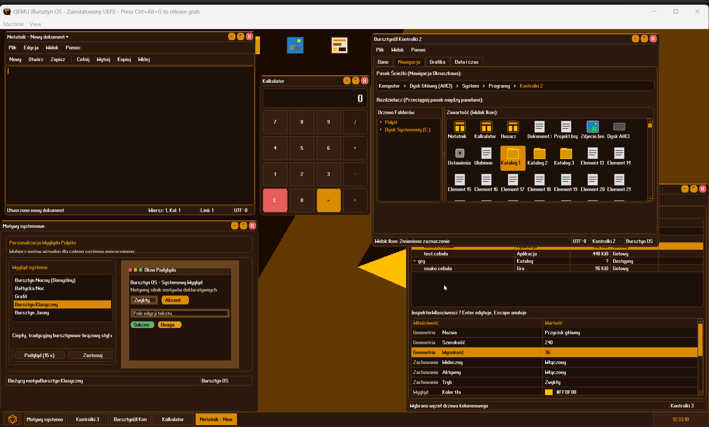
  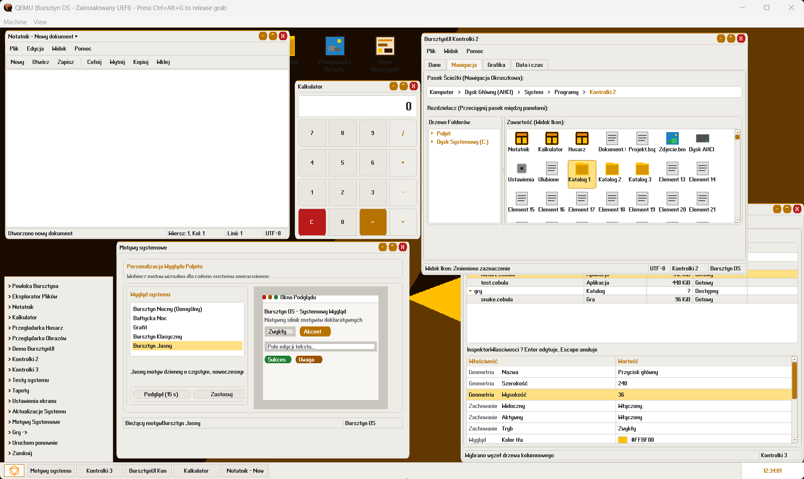
  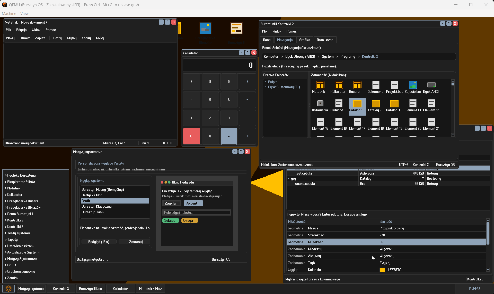
  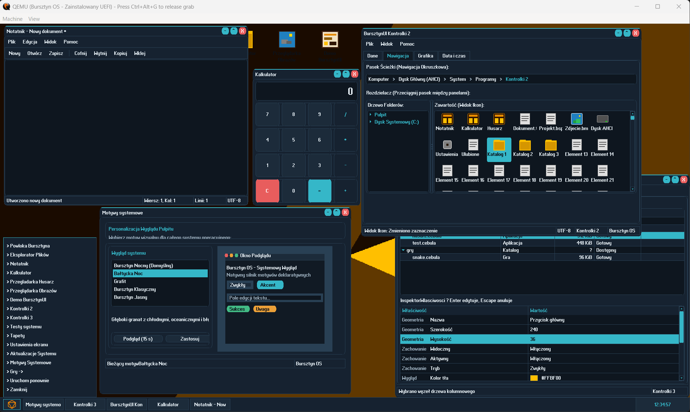
  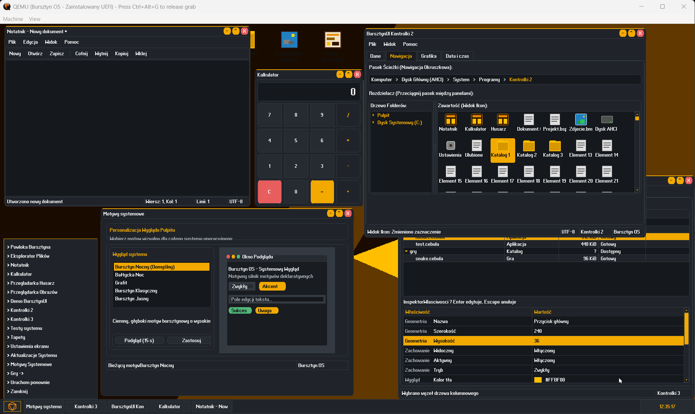
</p>


## Komponenty we frameworku Bursztyn UI
<p align="center">
  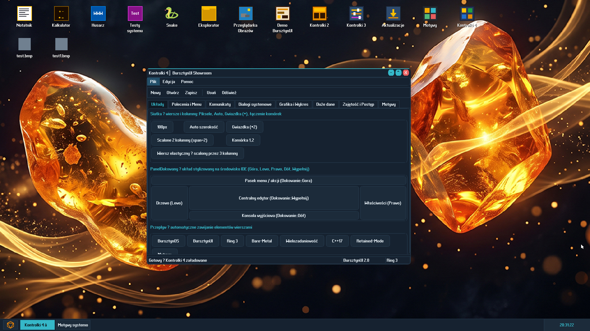
  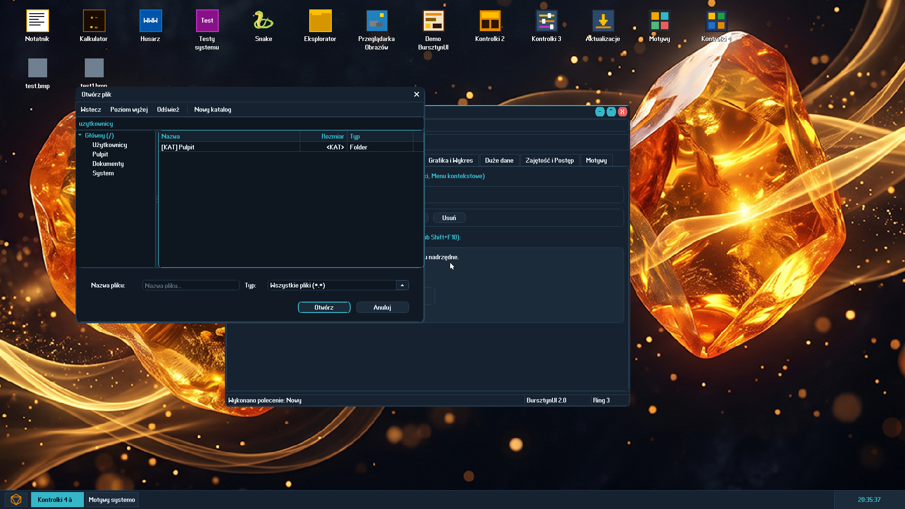
  
  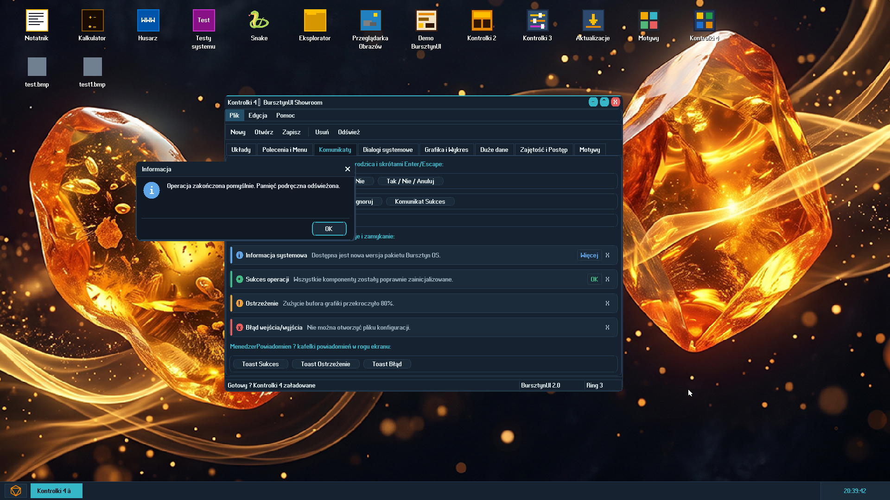
  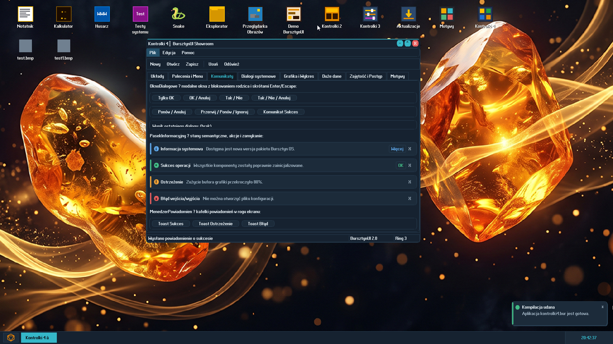
  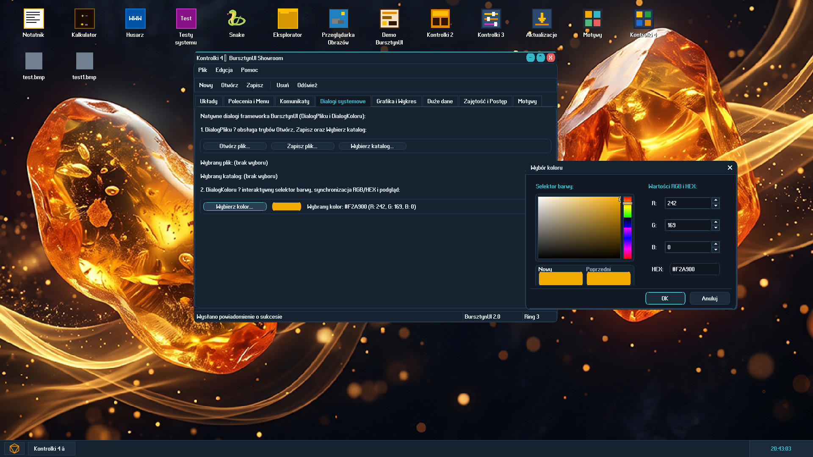
  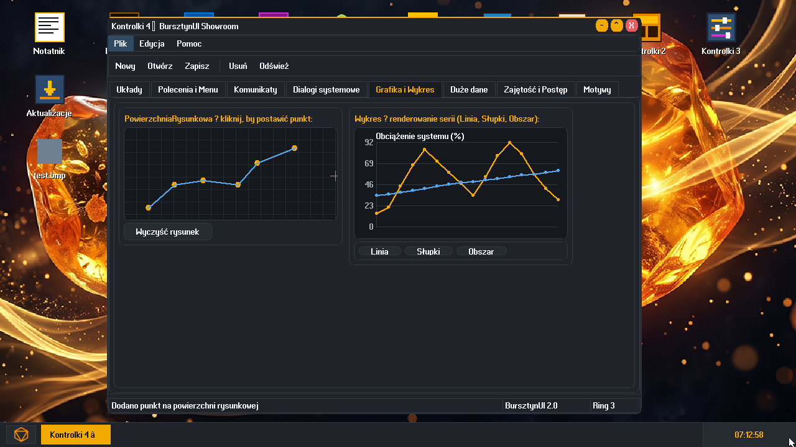
  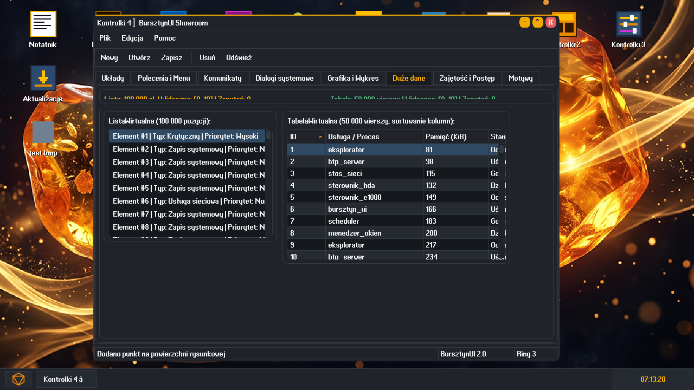
  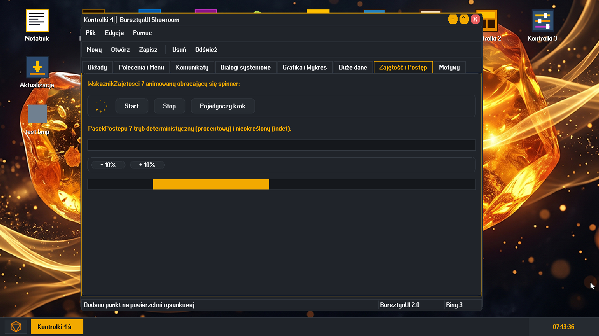
  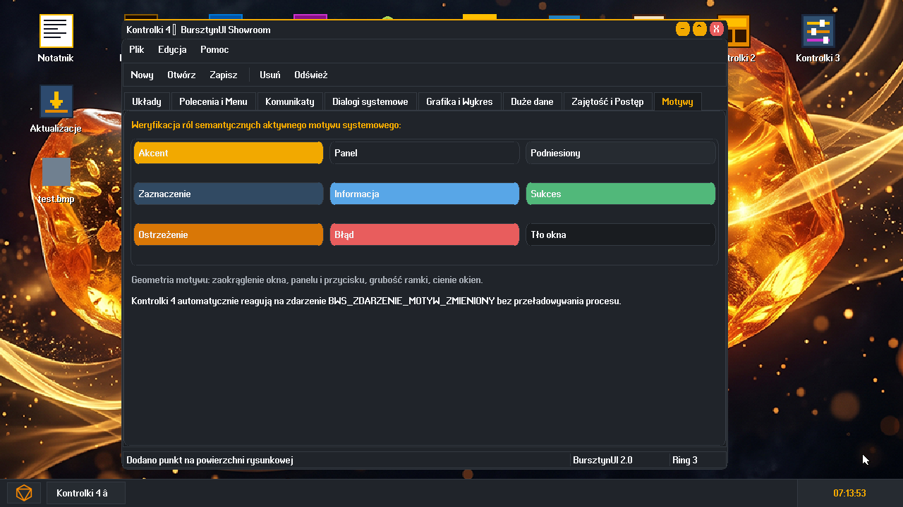
</p>


## Wsparcie projektu

Jeśli podoba Ci się Bursztyn OS i chcesz wesprzeć dalszy rozwój:

- [Zrzutka](https://zrzutka.pl/2k3z6u)
- [Patronite](https://patronite.pl/programista-art)
