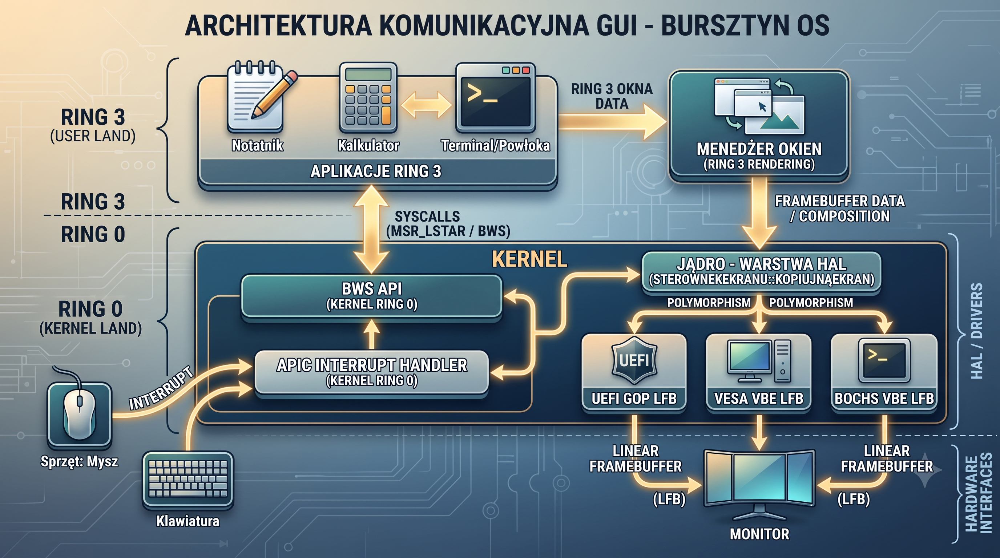

# 09. Wieloplatformowy Tryb Graficzny, Warstwa HAL i Architektura Ring 3

**Stan dokumentu:** aktualizacja 2026-09-18  
**Zakres:** backendy ekranu, framebuffer, bufory PMM/VMM, kompozytor, Menedżer Okien Ring 3, BursztynUI, dynamiczna rozdzielczość, skalowanie UI, popupy, input routing i ograniczenia aktualnej implementacji  
**Status:** aktywnie rozwijany i stabilizowany podsystem graficzny

---

## 9.1 Cel architektury graficznej

Bursztyn OS posiada własny stos graficzny rozwijany od warstwy sprzętowej aż do aplikacji Ring 3.

Aktualną architekturę można uprościć do:

```text
sprzęt / firmware / emulator
        ↓
UEFI GOP / VESA VBE / Bochs VBE
        ↓
SterownikEkranu / HAL
        ↓
framebuffer + bufory PMM/VMM
        ↓
kompozytor
        ↓
warstwy procesów Ring 3
        ↓
Menedżer Okien
        ↓
BursztynUI
        ↓
aplikacje .bur / .cebula
```

System nie jest nakładką na gotowy desktop ani biblioteką graficzną innego systemu operacyjnego.

Jednocześnie nie należy opisywać obecnej implementacji jako w pełni sprzętowo niezależnej lub produkcyjnie dojrzałej. Aktualny stos GUI działa realnie, ale pozostaje aktywnie rozwijany, szczególnie w obszarze:

- wysokich rozdzielczości,
- popupów i dialogów,
- cyklu życia dużych buforów,
- zmian generacji ekranu,
- przyszłej akceleracji GPU,
- przyszłego SMP i wielomonitorowości.

---

# 9.2 HAL ekranu

Warstwa graficzna używa wspólnej abstrakcji:

```text
SterownikEkranu
```

oraz konkretnych backendów sprzętowych.

Aktualnie istnieją trzy główne ścieżki:

1. **UEFI GOP**
2. **VESA VBE**
3. **Bochs VBE**

Własna warstwa HAL pozwala wyższym poziomom grafiki operować na wspólnym modelu ekranu niezależnie od sposobu uzyskania framebufferu.

---

# 9.3 UEFI GOP

UEFI GOP jest używany w nowoczesnej ścieżce firmware UEFI.

Bootloader przekazuje do Bursztyn OS informacje framebufferu przez Multiboot2.

Jądro korzysta z otrzymanych parametrów:

```text
adres framebufferu
szerokość
wysokość
pitch
bpp
format pikseli
```

Po wejściu do systemu zwykłe renderowanie nie wymaga runtime EFI.

### Aktualne ograniczenie

Backend GOP należy traktować głównie jako **statyczny tryb startowy**.

Aktualny runtime dynamicznej zmiany rozdzielczości nie korzysta z GOP w taki sam sposób jak Bochs VBE.

Jeśli zapisany tryb nie może zostać ustawiony przez aktywny backend, system zachowuje tryb startowy, ale może nadal zastosować zapisaną skalę UI.

---

# 9.4 VESA VBE

VESA VBE jest ścieżką przeznaczoną dla środowisk BIOS/legacy, w których bootloader przekazuje liniowy framebuffer.

Tak jak GOP, bieżący VESA backend jest przede wszystkim źródłem statycznego framebufferu startowego.

Nie należy zakładać, że każda maszyna VESA pozwala Bursztyn OS dowolnie zmieniać rozdzielczość w runtime.

---

# 9.5 Bochs VBE

Bochs VBE jest obecnie najważniejszym backendem do rozwoju i testów dynamicznego podsystemu ekranu w QEMU.

Sterownik komunikuje się z rejestrami DISPI przez:

```text
0x01CE
0x01CF
```

i może:

- wykrywać VRAM,
- walidować tryb,
- przełączać fizyczną rozdzielczość,
- współpracować z aktualnym mechanizmem rollbacku.

Bochs VBE nie jest po prostu „fallbackiem dla starych emulatorów”. W obecnym projekcie jest też głównym backendem do testowania dynamicznych zmian trybu.

---

# 9.6 Wybór backendu

Wybór aktywnego backendu zależy od informacji otrzymanych podczas rozruchu i wykrytego środowiska.

Schemat logiczny:

```text
Multiboot2 / framebuffer info
         ↓
wykrywanie możliwości platformy
         ↓
SterownikEkranu
         ├── UEFI GOP
         ├── VESA VBE
         └── Bochs VBE
```

Dokładna kolejność detekcji i fallbacku powinna pozostawać zgodna z aktualnym kodem HAL.

---

# 9.7 Placement New

Bursztyn OS używa C++ w środowisku bare-metal bez pełnej standardowej infrastruktury runtime znanej z systemów hostowanych.

Dla obiektów sterowników używane są techniki odpowiednie dla własnego środowiska, w tym placement new.

Nie należy jednak przedstawiać placement new jako mechanizmu, który sam w sobie „chroni przed BSOD”.

Jego rola jest bardziej precyzyjna:

> pozwala skonstruować poprawny obiekt C++ wraz z tablicą funkcji wirtualnych w pamięci kontrolowanej przez kernel, bez wymagania standardowego alokatora `new` z libstdc++.

Bezpieczeństwo nadal zależy od:

- poprawnego czasu życia obiektu,
- właściwej pamięci,
- poprawnej detekcji backendu,
- braku użycia obiektu po zniszczeniu.

---

# 9.8 Framebuffer

Framebuffer jest fizycznym celem końcowej prezentacji obrazu.

Kod nie powinien zakładać:

```text
pitch == width * 4
```

bez weryfikacji parametrów aktywnego trybu.

Dla typowych trybów XRGB8888:

```text
bytes_per_pixel = 4
```

ale architektura powinna posługiwać się rzeczywistym stride/pitch sterownika.

---

# 9.9 Backbuffer i kompozycja

Bursztyn OS nie renderuje całej sceny bezpośrednio do fizycznego LFB przy każdej operacji aplikacji.

Używany jest model:

```text
powierzchnie aplikacji
      ↓
kompozytor
      ↓
backbuffer
      ↓
kursor / overlay
      ↓
framebuffer
```

Zmniejsza to migotanie i pozwala składać spójną klatkę.

---

# 9.10 Duże bufory nie są alokowane z kernel heap

Ważna zmiana współczesnej architektury:

> duże bufory grafiki nie są alokowane ze standardowej 16 MiB sterty kernela.

Backbuffer, bufor tapety i powierzchnie okien korzystają z dedykowanej puli:

```text
PMM/VMM graphics buffers
```

Audyt podsystemu ekranu dokumentuje osobną przestrzeń wirtualną:

```text
BUFORY_GRAFIKI_BAZA = 0xffff900000000000
```

oddzieloną od HHDM:

```text
0xffff800000000000
```

Dzięki temu duży bufor 4K nie zużywa zwykłej sterty `kmalloc`.

---

# 9.11 Huge Pages

W starszej dokumentacji znajdowało się stwierdzenie, że VMM mapuje „przestrzeń RAM blokami 2 MiB zamiast 4 KiB”.

Jest ono zbyt szerokie.

Bursztyn OS używa 2 MiB huge pages tam, gdzie architektura i wymagania mapowania na to pozwalają, ale nie oznacza to, że każda strona VMM lub każdy bufor graficzny jest mapowany wyłącznie przez huge pages.

Nowsze mechanizmy, takie jak SHM i część dedykowanych buforów, pracują na zwykłych stronach 4 KiB.

Poprawna dokumentacja powinna mówić:

> **VMM potrafi wykorzystywać 2 MiB huge pages w wybranych obszarach, natomiast dobór wielkości stron zależy od konkretnego mapowania.**

---

# 9.12 Dynamiczna lista trybów

Aplikacja `Ustawienia ekranu` nie utrzymuje fikcyjnej listy trybów niezależnej od aktywnego sterownika.

Pobiera listę z HAL.

W audytowanym środowisku QEMU/Bochs z 64 MiB VRAM udostępniono 9 trybów:

```text
800x600x32
1024x768x32
1280x720x32
1280x800x32
1360x768x32
1600x900x32
1920x1080x32
2560x1440x32
3840x2160x32
```

Tryb:

```text
1366x768
```

jest odrzucany przez bieżący backend Bochs z powodu wymaganego wyrównania szerokości do 8 pikseli.

Dzięki temu system nie reklamuje trybu, którego sprzętowy backend nie potrafi przedstawić zgodnie z oczekiwanym stride.

---

# 9.13 4K i VRAM

Dla XRGB8888:

```text
3840 × 2160 × 4
= 33 177 600 B
```

W audytowanym środowisku QEMU wykryto:

```text
64 MiB VRAM
```

więc 4K zostało zaakceptowane.

Gdy aktywny backend raportuje mniejszą ilość VRAM, tryb musi zostać odrzucony.

Lista dostępnych trybów jest więc zależna od rzeczywiście wykrytych możliwości urządzenia.

---

# 9.14 Skalowanie interfejsu

Aktualny system wspiera skale UI:

```text
100%
125%
150%
175%
200%
```

Skalowanie obejmuje natywne komponenty BursztynUI oraz elementy desktopu, m.in.:

- pasek tytułowy,
- przyciski okna,
- etykiety,
- tekst Unicode,
- standardowe przyciski,
- pola wyboru,
- kontrolki radiowe,
- listy,
- tabele,
- drzewa,
- widoki ikon i miniatur,
- paski przewijania,
- suwaki,
- Pasek Zadań,
- Menu Start,
- ikony pulpitu.

Legacy konsola VGA pozostaje odrębną ścieżką o stałym rastrze.

---

# 9.15 Rozdzielczość a skala UI

Fizyczna rozdzielczość i skala interfejsu są rozdzielone.

Przykład:

```text
1920x1080
+
150% UI
```

jest inną konfiguracją niż:

```text
1280x720
+
100% UI
```

BWS 62 zwraca informacje o:

- fizycznej rozdzielczości,
- work area,
- skali.

Aktualne pole:

```text
scale_x1000
```

pozwala Ring 3 otrzymać skalę bez operacji zmiennoprzecinkowych.

---

# 9.16 Work area

Obszar roboczy nie jest równy zawsze całemu ekranowi.

W obecnym modelu:

```text
work_x = 0
work_y = 0
work_szer = szer
work_wys = wys - ui_skaluj(40, skala)
```

czyli pomniejsza ekran o skalowaną wysokość Paska Zadań.

BWS 63 pozwala zaufanej usłudze publikować work area.

Zwykła aplikacja nie powinna móc globalnie zmieniać tego obszaru.

---

# 9.17 Zmiana rozdzielczości

Zmiana trybu nie jest prostym zapisem kilku rejestrów.

Aktualna architektura stosuje model przygotowania i atomowego commitu:

```text
prepare new graphics buffers
        ↓
prepare wallpaper
        ↓
validate target mode
        ↓
short display lock
        ↓
hardware mode switch
        ↓
swap graphics state
        ↓
update compositor geometry
        ↓
compose coherent frame
        ↓
unlock
        ↓
release old buffers
```

Kosztowne:

- alokacje,
- zerowanie,
- skalowanie tapety

są wykonywane poza globalnym lockiem ekranu.

---

# 9.18 Display lock

`zablokuj_ekran()` powinien obejmować tylko krótki fragment atomowy.

Audyt dokumentuje, że pod lockiem pozostają głównie:

- przełączenie rejestrów DISPI,
- podmiana aktywnych wskaźników buforów,
- aktualizacja geometrii kompozytora,
- złożenie spójnej klatki commit.

Poza lockiem wykonywane są:

- alokacje PMM/VMM,
- skalowanie tapety,
- zwalnianie starych buforów,
- zapis konfiguracji do filesystemu.

Jest to ważne dla responsywności i przyszłego SMP.

---

# 9.19 Potwierdzenie trybu i rollback

Po zmianie fizycznego trybu system nie zapisuje konfiguracji natychmiast jako trwałej.

Uruchamiany jest deadline:

```text
15 s
```

Użytkownik musi potwierdzić poprawny obraz.

Jeżeli potwierdzenie nie nadejdzie:

```text
ekran_obsluz_timeout()
```

przywraca poprzedni:

- tryb sprzętowy,
- stan grafiki,
- geometrię kompozytora.

Plik:

```text
/ustawienia/ekran.cfg
```

pozostaje przy ostatniej zatwierdzonej konfiguracji.

---

# 9.20 Trwała konfiguracja ekranu

Po potwierdzeniu:

```text
EKRAN_ZACHOWAJ
```

zapisuje konfigurację do:

```text
/ustawienia/ekran.cfg
```

i wykonuje:

- flush BSP2/PSF,
- odczyt weryfikujący.

Przy starcie system próbuje zastosować zapisaną skalę.

Jeżeli aktywny backend nie pozwala zmienić fizycznego trybu, zachowywany jest boot mode, ale prawidłowa skala UI może nadal zostać zastosowana.

---

# 9.21 Tapeta

Tapeta korzysta z własnego formatu:

```text
.btp
```

Aktualny model przygotowuje gotowy bufor tapety dla fizycznej rozdzielczości.

Przy zmianie trybu wykonywane jest jedno przeskalowanie z bufora scratch do nowej powierzchni.

Przy zmianie samej skali UI:

```text
0 ponownych odczytów tapety z dysku
0 ponownych dekodowań BTP
0 ponownych przeskalowań fizycznej tapety
```

Podczas zwykłej klatki compositor kopiuje gotową powierzchnię.

---

# 9.22 Menedżer Okien Ring 3

Menedżer Okien jest programem użytkownika:

```text
menedzer_okien.bur
```

działającym w Ring 3.

Obsługuje m.in.:

- pulpit,
- Pasek Zadań,
- Menu Start,
- ikony,
- aktywne okno,
- Z-Order,
- minimalizację,
- maksymalizację,
- zamykanie,
- rozmieszczanie okien,
- integrację ze skalą UI,
- zegar pulpitu.

Jest to ważny element architektury Bursztyn OS: logika desktopu nie musi być w całości częścią Ring 0.

---

# 9.23 Menedżer Okien a kompozytor

Nie należy utożsamiać tych dwóch elementów.

### Menedżer Okien

Ring 3:

```text
polityka desktopu
okna
focus
taskbar
menu
```

### Kompozytor

systemowa warstwa odpowiedzialna za:

```text
powierzchnie
Z-Order
składanie klatki
popup surfaces
backbuffer
present
```

Podział ten pozwala utrzymywać dużą część zachowania UI poza kernelem.

---

# 9.24 BursztynUI

Wczesne API `bursztyn_gui.h` rozwinęło się do frameworka:

```text
BursztynUI
```

Aktualny inwentarz projektu obejmuje około:

```text
58 wizualnych kontrolek/dialogów
```

oraz około:

```text
62 publiczne elementy frameworka
```

jeśli uwzględnić infrastrukturę poleceń i popupów.

Przykłady:

```text
Okno
Panel
Kolumna
Wiersz
Etykieta
Przycisk
PoleTekstowe
Tabela
Drzewo
WidokIkon
WidokMiniatur
TabelaWirtualna
ListaWirtualna
EdytorFormatowany
PoleWyszukiwania
SelektorKoloru
PowierzchniaRysunkowa
Wykres
OknoDialogowe
DialogPliku
DialogKoloru
DialogKomunikatu
Powiadomienie
PolecenieUI
ZarzadcaPopupow
```

Framework nadal jest rozwijany i liczba elementów może rosnąć.

---

# 9.25 Dialogi

Nowszy BursztynUI posiada wyspecjalizowane dialogi:

```text
DialogPliku
DialogKoloru
DialogKomunikatu
```

`DialogPliku` obsługuje tryby:

```text
Otworz
Zapisz
WybierzKatalog
```

oraz m.in.:

- nawigację,
- PasekSciezki,
- listowanie katalogu,
- filtry,
- nazwę pliku,
- tworzenie katalogu,
- potwierdzenie nadpisania.

`DialogKoloru` łączy:

- SelektorKoloru,
- preview,
- RGB,
- HEX,
- synchronizację pól.

To komponenty Ring 3, a nie osobne syscalle kernela.

---

# 9.26 Popupy top-level

Stara architektura traktowała część popupów zbyt mocno jako fragment powierzchni właściciela.

Powodowało to problemy takie jak:

- clipping przy granicy okna,
- pozostawianie śladów podczas drag,
- błędne toast notifications.

Nowsza architektura używa odłączonych:

```text
top-level popup surfaces
```

publikowanych do kompozytora.

Dotyczy to m.in.:

- menu,
- dialogów,
- tooltipów,
- toastów.

---

# 9.27 Damage popupów

Przesunięcie popupu wymaga odświeżenia:

```text
old bounds
+
new bounds
+
shadow extent
```

Brak old damage pozostawia ślady starej pozycji.

Nowsza ścieżka popupów jest więc bardziej lokalna niż historyczny globalny `dirty`.

Nie oznacza to jednak jeszcze, że cały compositor jest kompletnym tile-based damage rendererem.

---

# 9.28 Generacja ekranu

Zmiana fizycznego trybu powoduje zmianę:

```text
generacja_ekranu
```

Zasoby zależne od framebufferu, szczególnie popup surfaces, muszą być zgodne z aktywną generacją.

Jeżeli:

```text
popup.generacja_ekranu != aktualna_generacja
```

powierzchnia jest nieaktualna i nie może zostać użyta do prezentacji.

Mechanizm chroni przed użyciem buforów utworzonych dla starej geometrii po przełączeniu np.:

```text
1280x720
→ 1920x1080
```

---

# 9.29 Inwalidacja a lifetime

Samo oznaczenie starej powierzchni jako nieważnej nie może pozostawić przydzielonych:

- ramek PMM,
- mapowań VMM,
- slotu puli graficznej,
- capture/modal state.

Poprawny model:

```text
invalidate
→ detach
→ release backing resource
```

albo:

```text
rebuild for new generation
```

Jeżeli popup był modalny, jego inwalidacja musi także poprawnie zwolnić lub przebudować:

- capture,
- focus,
- modalność.

W przeciwnym razie niewidoczny popup może nadal blokować aplikację.

---

# 9.30 Focus, capture i input routing

Stary model globalnego odczytu myszy został zastąpiony per-process Event ABI.

Aktualna ścieżka:

```text
PS/2 lub USB HID
      ↓
event
      ↓
hit-test
      ↓
focus / capture
      ↓
docelowy PID
      ↓
bounded event queue
      ↓
BursztynUI
```

Ruch wskaźnika może być scalany.

Kliknięcie nie powinno być rekonstruowane niezależnie przez wiele procesów z jednego globalnego bitu przycisku.

---

# 9.31 BWS GUI

Współczesne GUI korzysta z większego zestawu BWS niż historyczne 14–24.

Istotne numery obejmują m.in.:

```text
33 — create/replace own layer
34 — move own layer
37 — event poll
38 — event wait
39 — input capture
40 — system overlay
41 — minimize own layer
42 — window snapshot
43 — activate window
49 — drop target registration
50 — drag update/drop
56 — application popup
57 — GUI blit
58 — window title
61 — own-window geometry
62 — monitor/work-area/DPI info
63 — trusted work-area publish
77 — system cursor
78 — custom cursor
```

Nowsze aplikacje nie powinny opierać całej architektury na legacy:

```text
18 — globalny stan myszy
22 — historyczne mouse ownership
```

---

# 9.32 BWS 61 — geometria własnego okna

BWS 61 pozwala procesowi transakcyjnie zmienić:

```text
x
y
width
height
```

własnej warstwy.

Model powinien działać:

```text
validate
→ prepare
→ commit
→ damage
→ release old
```

Aplikacja nie może w ten sposób zmienić warstwy należącej do obcego PID.

---

# 9.33 Kursor

Kursor jest overlayem końcowej fazy klatki.

IRQ myszy nie powinien bezpośrednio:

```text
restore old background
draw cursor
```

na potencjalnie nieaktualnym backbufferze.

Nowsze BWS umożliwiają również:

```text
BWS 77 — system cursor shape
BWS 78 — custom cursor
```

Custom cursor jest kopiowany do pamięci należącej do systemu, a maksymalny rozmiar udokumentowanego ABI wynosi:

```text
64x64
```

---

# 9.34 Pacing kompozytora

HPET jest używany do pacingu GUI.

Pełna klatka jest ograniczona do około:

```text
16 666 667 ns
```

czyli około:

```text
60 Hz
```

Dirty pozostaje pending do deadline.

Timer IRQ nie wykonuje pełnej kompozycji.

Oczekującą pracę wykonuje PID 0 poza IRQ.

---

# 9.35 60 Hz nie oznacza stałego render loop

Pacing określa maksymalną częstotliwość pełnej klatki.

Jeśli:

```text
dirty = false
```

system nie musi renderować 60 razy na sekundę.

Ogranicza to:

- pracę CPU,
- kopie framebufferu,
- koszt pamięciowy,
- zbędną aktywność przy bezczynnym pulpicie.

---

# 9.36 Zegar pulpitu

Zegar na Pasku Zadań nie zależy już od ruchu myszy.

System dostarcza scalany timer event mniej więcej raz na sekundę.

Menedżer Okien:

1. odczytuje RTC,
2. porównuje czas,
3. oznacza GUI jako dirty tylko przy rzeczywistej zmianie.

---

# 9.37 Tapety i format BTP

Bursztyn OS posiada własny format tapet:

```text
.btp
```

oraz aplikację Tapety i narzędzia konwersji.

Aktualny model oddziela:

```text
dekodowanie / przygotowanie tapety
```

od:

```text
kopiowanie gotowej powierzchni podczas kompozycji
```

co ogranicza pracę per-frame.

---

# 9.38 Motywy

Nowszy system posiada globalny podsystem motywów.

BWS:

```text
86 — pobierz motyw
87 — polecenia motywu
```

BursztynUI powinien pobierać aktualne wartości motywu przez wspólny mechanizm, zamiast utrzymywać niezależne, ręcznie duplikowane kolory w każdej aplikacji.

Docelowo zmiana motywu powinna być propagowana jako zdarzenie/generacja systemowa do aplikacji.

Aktualna synchronizacja motywów pozostaje obszarem aktywnej stabilizacji.

---

# 9.39 Aplikacje Ring 3

Ekosystem graficzny jest większy niż trzy aplikacje wymieniane w starej dokumentacji.

Aktualnie projekt zawiera m.in.:

- Notatnik,
- Kalkulator,
- Przeglądarkę zdjęć,
- Husarza — eksperymentalny klient/przeglądarkę WWW,
- Eksplorator plików,
- Powłokę Bursztynową,
- Ustawienia ekranu,
- Tapety,
- Aktualizacje Systemu,
- Testy Bursztyn OS,
- Snake,
- Instalator Bursztyn OS.

Nie wszystkie aplikacje są równie dojrzałe i nie należy nazywać całego ekosystemu produkcyjnie stabilnym.

---

# 9.40 UTF-8 i polski interfejs

BursztynUI i aplikacje Ring 3 używają UTF-8.

Obsługiwane są polskie znaki, a renderer używa proporcjonalnych metryk fontu.

System posiada BWS do:

- szerokości glifu,
- wysokości fontu.

Nie należy utożsamiać proporcjonalnego fontu z każdym znakiem mającym dokładnie 16 pikseli szerokości.

---

# 9.41 Pamięć 4K

Dla 3840×2160 XRGB8888 jeden pełny bufor ma:

```text
33 177 600 B
```

Dlatego architektura grafiki nie może zakładać, że wszystkie duże powierzchnie mieszczą się w małej stercie kernela.

Przy wysokich rozdzielczościach trzeba uwzględnić jednoczesną obecność m.in.:

- backbufferu,
- tapety,
- powierzchni aplikacji,
- popupów,
- buforów przygotowywanych podczas transakcyjnej zmiany trybu.

---

# 9.42 Historyczny wynik testów pamięci

Audyt ustawień ekranu z 2026-09-06 wykonał trzy cykle:

```text
1280x800
→ 1920x1080
→ 2560x1440
→ 1920x1080
→ 1280x800
```

i dla tej wersji kodu raportował:

```text
PMM delta  = 0
HEAP delta = 0
BUF delta  = 0
```

Był to wartościowy test konkretnej rewizji kodu.

Nie należy jednak przedstawiać go jako gwarancji dla wszystkich późniejszych zmian.

---

# 9.43 Aktualna regresja PMM/VMM

Po późniejszych zmianach popup/compositor/display-generation w obecnym cyklu rozwoju zaobserwowano:

```text
[EKRAN] BLAD puli PMM/VMM
```

To jest aktualny problem wymagający diagnozy.

Nie należy go „naprawiać” wyłącznie przez zwiększenie limitu puli bez udowodnienia, że:

```text
PMM free frames delta = 0
VMM mapped pages delta = 0
active graphics buffers delta = 0
```

po pełnym cyklu zmian rozdzielczości i popupów.

Podejrzane obszary:

- zasoby popupów starej generacji,
- combined popup submission,
- rollback częściowej alokacji,
- zwalnianie framebuffer-dependent surfaces,
- accounting puli PMM/VMM.

---

# 9.44 Wymagany model rollbacku alokacji

Jeśli przygotowanie dużego bufora nie powiedzie się po częściowym zmapowaniu stron, kod musi wycofać całą częściową operację:

```text
allocation begin
   ↓
frame 1 mapped
frame 2 mapped
...
frame N allocation fails
   ↓
unmap all mapped pages
free all acquired frames
release virtual range
restore metadata
```

Brak pełnego rollbacku może prowadzić do stopniowego wyczerpania puli przy kolejnych próbach.

---

# 9.45 Odmapowanie bufora

Poprawna ścieżka zwalniania powinna dla każdej strony:

1. odczytać ramkę fizyczną z PTE,
2. wyczyścić PTE,
3. wykonać invalidację TLB, np. `invlpg`,
4. zwrócić ramkę do PMM,
5. zwolnić metadata/slot zakresu VMM.

Zasób nie jest naprawdę zwolniony tylko dlatego, że jego pointer został ustawiony na `nullptr`.

---

# 9.46 VirtIO-GPU

VirtIO-GPU może być przyszłym lub pośrednim backendem poprawiającym przepustowość i integrację z QEMU.

Nie rozwiązuje jednak automatycznie:

- własności powierzchni,
- błędów lifetime,
- stale generation,
- synchronizacji motywów,
- focus/capture,
- semantyki popupów.

Backend GPU nie zastępuje poprawnego modelu kompozytora.

---

# 9.47 Brak akceleracji GPU

Aktualny rendering jest w dużej mierze wykonywany przez CPU i framebuffer.

Nie należy obecnie deklarować:

- OpenGL,
- Vulkan,
- Direct3D,
- sprzętowej kompozycji GPU,
- shaderów,
- pełnej akceleracji 2D/3D.

Sprzętowa akceleracja pozostaje przyszłym etapem.

---

# 9.48 Wielomonitorowość

BWS 62 i struktura informacji o monitorze są projektowane w sposób możliwy do rozszerzenia.

Aktualna implementacja jest jednak praktycznie:

```text
single-monitor
```

Nie należy opisywać Bursztyn OS jako systemu z pełną obsługą wielu monitorów, dopóki nie zostaną wdrożone:

- enumeracja wielu wyjść,
- osobne work areas,
- routing okien między monitorami,
- per-monitor scale,
- zmiany hotplug.

---

# 9.49 Jednordzeniowość

Projekt pozostaje UP.

Obecny model lifetime powierzchni działa w prostszym środowisku niż przyszły compositor SMP.

Przed SMP szczególnie ważne będzie zastąpienie części surowych pointerów modelem:

- ownership,
- refcount,
- snapshot,
- kontrolowany lifecycle.

Nie należy projektować nowych elementów GUI w sposób zakładający, że zawsze tylko jeden CPU może dotknąć sceny.

---

# 9.50 Ograniczenia synchronicznego TLS

HTTP/HTTPS/TLS mają nadal istotne ścieżki synchroniczne w Ring 0.

Długie operacje mogą powodować zauważalne zatrzymania GUI.

Timer nadal obsługuje IRQ/EOI, ale scheduler nie powinien arbitralnie przełączać procesu w środku nieprzystosowanego syscalla.

Docelowe rozwiązanie wymaga:

```text
WAITING_IO
+
state machine / worker
+
completion event
```

a nie sztucznego preemptowania TLS.

---

# 9.51 Aktualny status stabilności

Podsystem graficzny jest funkcjonalny i posiada szeroki zestaw testów automatycznych.

Audyt ustawień ekranu raportował:

```text
PASS assertions = 31128
FAIL assertions = 0
```

dla swojej wersji.

Jednocześnie audyt oznaczono:

```text
NOT MANUALLY VERIFIED BY HUMAN
```

a późniejsze zmiany w popupach/generacjach ujawniły regresję puli PMM/VMM.

Dlatego aktualny opis powinien brzmieć:

> **GUI Bursztyn OS jest zaawansowanym, funkcjonalnym środowiskiem Ring 3 z własnym HAL, kompozytorem i BursztynUI, pozostającym w aktywnej fazie stabilizacji.**

Nie należy określać go jako „w pełni ustabilizowanego nowoczesnego systemu okienkowego”.

---

# 9.52 Zalecane testy regresyjne

Po każdej większej zmianie kompozytora lub buforów należy wykonywać:

### Backend / tryby

```text
1280x720
800x600
1024x768
1280x800
1360x768
1600x900
1920x1080
2560x1440
3840x2160
```

zgodnie z możliwościami wykrytego VRAM.

### Skalowanie

```text
100%
125%
150%
175%
200%
```

### GUI

```text
window create/close
move
resize
maximize
minimize
DialogPliku
DialogKoloru
menu
tooltip
toast
nested popup
```

### Zmiany ekranu

```text
1280x720
→ 1920x1080
→ open dialogs
→ 2560x1440
→ open/close popup stack
→ 1920x1080
→ 1280x720
```

### Pamięć

Na końcu:

```text
PMM delta = 0
VMM mapped-page delta = 0
graphics-buffer delta = 0
popup backing delta = 0
```

---

# 9.53 Architektura komunikacyjna GUI

Aktualny przepływ jest bardziej rozbudowany niż w starej wersji:

```text
┌──────────────────────────────────────────────┐
│                Aplikacja Ring 3              │
│                                              │
│  .bur + BursztynUI + logika aplikacji        │
└───────────────────┬──────────────────────────┘
                    │
                    │ BWS / event queue / SHM / IPC
                    ▼
┌──────────────────────────────────────────────┐
│            Warstwa systemowa grafiki         │
│                                              │
│  layers / popup surfaces / cursor / damage   │
│  compositor / display generation             │
└───────────────────┬──────────────────────────┘
                    │
                    ▼
┌──────────────────────────────────────────────┐
│              Bufory PMM/VMM                  │
│                                              │
│  backbuffer / wallpaper / surfaces           │
└───────────────────┬──────────────────────────┘
                    │
                    ▼
┌──────────────────────────────────────────────┐
│                HAL ekranu                    │
│                                              │
│  UEFI GOP | VESA VBE | Bochs VBE             │
└───────────────────┬──────────────────────────┘
                    │
                    ▼
               framebuffer
```

Oryginalny diagram projektu może pozostać w dokumentacji:



Jeżeli grafika przedstawia stary model BWS 14–24 lub globalny polling myszy, powinna zostać zaktualizowana osobno, aby odpowiadała obecnemu Event ABI i warstwie popupów.

---

# 9.54 Co zostało zmienione względem starego dokumentu

Najważniejsze korekty:

1. zachowano trzy backendy: GOP, VESA i Bochs VBE;
2. Bochs opisano jako aktywny backend dynamicznych testów, nie tylko „fallback”;
3. usunięto absolutne stwierdzenie o pełnej sprzętowej niezależności;
4. doprecyzowano rolę placement new;
5. huge pages nie są już opisywane jako jedyna wielkość stron w całym VMM;
6. duże bufory grafiki opisano jako zasoby dedykowanej puli PMM/VMM;
7. dodano dynamiczną listę trybów do 4K;
8. dodano skale 100–200%;
9. dodano 15-sekundowy rollback;
10. dodano `/ustawienia/ekran.cfg`;
11. dodano BursztynUI i około 62 publiczne elementy frameworka;
12. dodano dialogi, popupy top-level i powiadomienia;
13. dodano display generation;
14. dodano aktualny model focus/capture/event queue;
15. dodano nowoczesne BWS GUI;
16. dodano pacing 60 Hz oparty na HPET;
17. dodano system motywów;
18. rozszerzono listę aplikacji Ring 3;
19. dodano aktualną regresję `[EKRAN] BLAD puli PMM/VMM`;
20. usunięto stwierdzenie, że cały podsystem jest już „w pełni ustabilizowany”.

---

# 9.55 Podsumowanie

Aktualny stos graficzny Bursztyn OS obejmuje:

```text
UEFI GOP
VESA VBE
Bochs VBE
      ↓
SterownikEkranu
      ↓
dedykowane bufory PMM/VMM
      ↓
kompozytor
      ↓
warstwy i popupy
      ↓
Menedżer Okien Ring 3
      ↓
BursztynUI
      ↓
aplikacje .bur / .cebula
```

Najważniejsze działające funkcje obejmują:

- własny framebuffer HAL,
- własny kompozytor,
- Menedżer Okien Ring 3,
- okna i Z-Order,
- focus/capture,
- Event ABI,
- popupy,
- dialogi,
- BursztynUI,
- dynamiczne tryby Bochs do 4K przy odpowiednim VRAM,
- skale UI 100–200%,
- rollback rozdzielczości,
- trwałą konfigurację ekranu,
- tapety BTP,
- motywy,
- natywne aplikacje Ring 3.

Najważniejsze dalsze prace:

- naprawa regresji PMM/VMM,
- pełne testy popupów po zmianie generacji,
- pełniejszy damage compositor,
- wielomonitorowość,
- async I/O dla aplikacji sieciowych,
- VirtIO-GPU / przyszła akceleracja,
- przygotowanie lifetime powierzchni pod SMP.

---

## 9.56 Dokumenty powiązane

Aktualny stan należy czytać razem z:

- `02_architektura_systemu.md` — Ring 0/Ring 3 i bezpieczeństwo,
- `04_audyt_gui_schedulera.md` — input routing, focus/capture i compositor scheduling,
- `04_zarzadzanie_sprzetem.md` — backendy sprzętowe i MMIO,
- `05_hpet_i_pacing.md` — pacing 60 Hz i scheduler,
- `06_wywolania_systemowe.md` — aktualne BWS GUI,
- `07_ekosystem_i_formaty.md` — aplikacje `.bur` i `.cebula`,
- `08_bursztynowy_slownik_i_architektura.md` — nazewnictwo BursztynUI,
- `ustawienia_ekranu_audyt.md` — tryby, pamięć, rollback i skalowanie.

Przy rozbieżnościach pierwszeństwo powinny mieć:

1. aktualny kod HAL i kompozytora,
2. aktualny kod `bufory_grafiki.cpp`,
3. bieżące logi runtime,
4. `ustawienia_ekranu_audyt.md`,
5. najnowsze testy GUI,
6. starsza dokumentacja opisowa.
